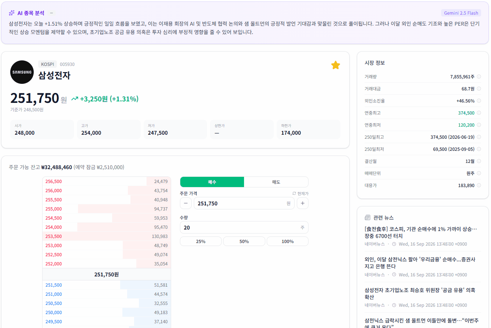
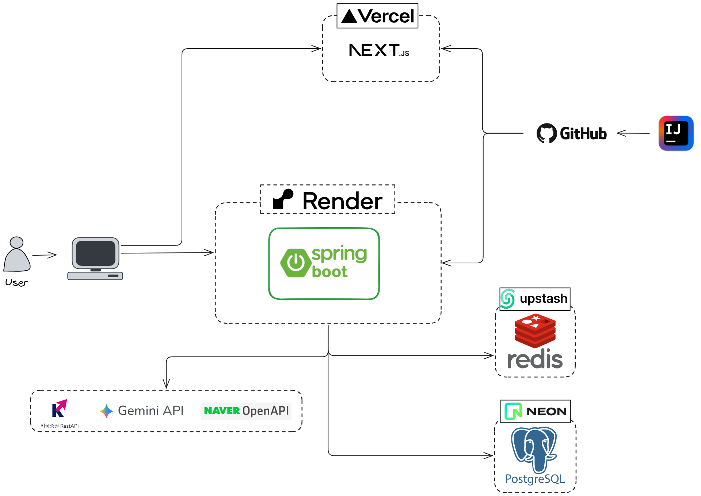
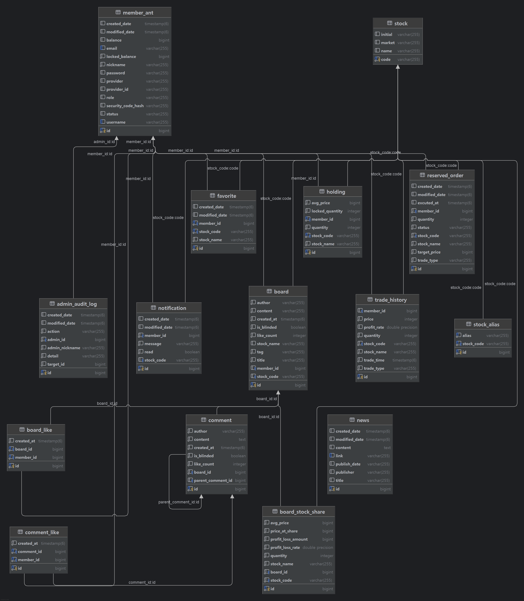

# 개인 투자자를 위한 모의투자 플랫폼 - gaemiZIP

> [gaemiZIP 보러가기](https://gaemi-zip.vercel.app)

개인 투자자("개미")를 위한 실시간 시세·모의 매매·커뮤니티·AI 시장 분석을 제공하는 1인 풀스택 프로젝트입니다.
백엔드 설계·구현·인프라를 전담했고, 프론트엔드는 AI 도구로 구현 후 직접 검증·수정했습니다.



> 백엔드는 무료 티어라 15분 미접속 시 슬립 상태가 됩니다 — 첫 접속 시 콜드스타트로 30~60초 정도 걸릴 수 있습니다.

---
##  핵심 기능

- **실시간 시세/차트**: 키움 WebSocket 체결·호가 실시간 반영, 캔들 차트(1~60분·D·W), 코스피/코스닥/코스피200 지수
- **모의 매매**: 즉시 체결 매수/매도, 지정가 예약 주문(현재가 도달 시 자동 체결) + 체결 알림
- **인증**: JWT 기반 인증 + Google OAuth, 신규 가입 시 1억 원 초기 잔고와 랜덤 닉네임 자동 부여
- **커뮤니티**: 게시판(태그·인기글·보유종목 공유) + 댓글/대댓글, 추천 1인 1회 제한
- **AI 시장 분석**: 최신 뉴스 기반 Gemini 2.5 Flash 시장 테마·관련 종목 분석
- **관리자 모드**: 회원 정지, 콘텐츠 블라인드, 잔고/거래 수동 보정 + 감사 로그, 통계 대시보드

---
##  기술 스택

| 구분 | 스택 |
|---|---|
| 백엔드 | Java 21, Spring Boot 4.0.2, Spring Security + JWT, Spring Data JPA + QueryDSL 5, Spring WebSocket, WebFlux(WebClient), Bucket4j |
| 프론트엔드 | Next.js 16 (App Router) + React 19, TypeScript, Tailwind CSS 4, Zustand, TanStack React Query, lightweight-charts |
| 데이터베이스 | PostgreSQL 18, Redis |
| 인프라 | Docker Compose, GitHub Actions |
| 테스트/부하검증 | JUnit 5, k6 |
| 외부 연동 | 키움증권 Open API+(모의투자, WebSocket/REST), Google Gemini 2.5 Flash, 네이버 뉴스 검색 API, Google OAuth 2.0 |

---
##  트러블 슈팅

### 1. 같은 데이터를 동시에 수정할 때 값이 유실되는 동시성 결함

> **요약**: 예약 체결·즉시 주문에서 같은 데이터를 동시에 수정할 때 값이 유실되던 결함을 비관적 락으로 해결 (재현율 20/20회 → 0회). 이후 락과 주문 단위 트랜잭션을 추가하며 병렬 처리량은 일부 감소했지만, 금액이 오가는 로직이라 속도보다 정합성을 우선해 수용

**증상**
- 예약 체결을 종목코드 단위로 병렬화하자 가설(잔고 lost update)과 달리 결함 2건 발견
  - 최초 매수: `Holding` 유니크 제약 부재로 동시 INSERT 예외 (20/20회)
  - 기존 보유 매수: 거래이력·알림이 스레드 수(4배)만큼 중복 생성 (20/20회), 잔고는 우연히 같은 값이라 정상처럼 보임
- 즉시 매수에서도 같은 유형 재현: 응답은 200인데 이력 11건 대비 보유 수량 일부만 반영(2~5), 잔고도 일부만 차감 (20/20회)

**원인**
- 예약 체결(`matchAndExecute`): 같은 종목의 대기 주문을 락 없이 읽어, 동시 호출 시 각 스레드가 같은 주문 목록을 독립적으로 처리
- `Holding`에 (회원, 종목) 유니크 제약이 없어 최초 매수 시 중복 INSERT 가능
- 즉시 매수/매도(`TradeService`): 회원 행에 락이나 `@Version` 없이 "조회 → 잔고 차감 → 보유 갱신"을 수행해 같은 행을 서로 덮어씀

**해결**
- 예약 체결(최초 수정, 커밋): 종목코드 단위 비관적 락(`@Lock(PESSIMISTIC_WRITE)`) + `Holding` 유니크 제약
- 즉시 매수/매도: 회원 행 조회에 `@Lock(PESSIMISTIC_WRITE)` 적용, 같은 계정의 동시 주문 직렬화
- 후속 측정에서 예약 체결 ↔ 즉시 주문 교차 경합(조용한 유실)과 예약 취소 ↔ 체결 데드락이 추가로 확인되어 구조를 변경
  - 예약 체결·취소·생성에 회원 행 락을 추가하고, 락을 함께 잡는 경로는 모두 "주문 행 → 회원 행" 순서로 통일 (즉시 주문과 예약 생성은 회원 행만 잠금)
  - 체결을 "후보 조회(락 없음) → 주문마다 새 트랜잭션(`REQUIRES_NEW`)에서 주문 행 잠금·상태 재확인 → 회원 행 잠금"으로 바꿔, 한 주문의 예외가 같은 종목의 다른 주문을 롤백하지 않게 격리 (현재 `main` 구조)

<details>
<summary>코드: 예약 체결 (기존 → 최초 수정, 커밋 `0f2ee8c` 기준 / 현재 구조는 위 "후속" 항목 참고)</summary>

기존
```java
// ReservedOrderRepository
List<ReservedOrder> findByStockCodeAndStatus(String stockCode, TradeStatus status);
```

수정
```java
// ReservedOrderRepository: 종목코드 단위로 대기 주문을 잠그고 조회
@Lock(LockModeType.PESSIMISTIC_WRITE)
@Query("select o from ReservedOrder o where o.stock.code = :stockCode and o.status = :status")
List<ReservedOrder> findByStockCodeAndStatusForUpdate(@Param("stockCode") String stockCode,
                                                      @Param("status") TradeStatus status);

// Holding: 같은 회원·종목의 중복 INSERT를 DB가 막도록 안전망 추가
@Table(uniqueConstraints = @UniqueConstraint(columnNames = {"member_id", "stock_code"}))
public class Holding { ... }
```
</details>

<details>
<summary>코드: 즉시 매수/매도 (기존 → 수정)</summary>

기존
```java
// TradeService.executeBuy / executeSell
MemberAnt member = findMember(email);   // 락 없이 조회 → 동시 요청이 같은 값을 읽음
```

수정
```java
// TradeService.executeBuy / executeSell
MemberAnt member = findMemberForUpdate(email);   // 회원 행을 잠그고 조회

// MemberAntRepository
@Lock(LockModeType.PESSIMISTIC_WRITE)
@Query("select m from MemberAnt m where m.username = :id or m.email = :id")
Optional<MemberAnt> findByLoginIdForUpdate(@Param("id") String id);
```
</details>

**검증**
- 예약 체결: JUnit(`ReservationRaceConditionTest`), `CountDownLatch`로 N스레드 동시 호출, 20회 반복
- 즉시 매수: k6(`k6/loadTest/test_buy.js`)로 같은 계정이 20 VU로 동시 매수, 락 없는 코드와 락 적용 코드를 같은 조건으로 실행하고 DB에서 이력·보유 수량·잔고를 직접 대조
- 즉시 매도: 보유 21주에서 1주씩 매도 요청 30개를 병렬 전송, 20회 반복
- 교차 경합(예약 체결 ↔ 즉시 주문·취소, 동시 예약 생성): JUnit 통합 테스트(`ReservationVsOrderRaceTest`, `ReservationEdgeCaseTest`), 실제 Postgres, `CountDownLatch`와 커밋 직전 지연으로 20회 반복

| 지표 | 수정 전 | 수정 후 |
|---|---|---|
| 예약 체결 결함 재현율 (2건) | 20/20회 (100%) | 0/20회 |
| 병렬 처리량(순차 대비), 종목 단위 락 도입(`0f2ee8c`) | 8.29~8.79배 | 8.18배 |
| 병렬 처리량(순차 대비), 회원 락·주문 순서 통일 (같은 환경, 각 2회) | 5.28 / 4.83배 | 5.12 / 4.79배|
| 병렬 처리량(건/s), 주문 단위 트랜잭션 분리 (같은 환경, 각 2회) | 243.5 / 313.2 | 202.0 / 224.5 (약 20~30% 감소) |
| 즉시 매수 어긋난 회차 | 20/20회 | 0/25회 |
| 즉시 매도 어긋난 회차 | 20/20회 | 0/20회 |
| 예약 체결 ↔ 즉시 매수 불일치 (통계 20회) | 20/20회 | 0/20회 |
| 예약 취소 ↔ 체결 데드락 예외 (통계 20회) | 20/20회 | 0/20회 |
| 예약 매도 체결 ↔ 같은 계정 즉시 매도 (20회) | 20/20회 불일치 | 해결 (회귀 테스트 통과) |
| 한 주문 예외 시 같은 종목 전체 롤백 | 재현됨 | 해결 (정상 주문은 체결, 예외 주문만 대기 유지) |

> 처리량은 측정 환경이 달라 행끼리 절대값을 비교할 수 없고, 각 행의 수정 전/후만 비교해야 한다.

즉시 매수 동시 주문 비교 (20 VU, 같은 계정, 장 시간 실측)

| 지표 | 락 없음 | 락 적용 |
|---|---|---|
| 성공 / 서버 오류 | 11 / 9 | 20 / 0 |
| 매수 이력 / 보유 수량 | 11 / 3 | 20 / 20 |
| 최종 잔고 | 99,790,000 (기대 99,230,000) | 98,600,000 (기대값 일치) |

**선택 이유와 트레이드오프**
- 비관적 락 선택: 같은 계정 안의 충돌이 짧고 드물어 대기 비용이 작고, 낙관적 락은 충돌 시 재시도 코드가 필요. 예약 체결에서 이미 같은 방식 사용
- 트레이드오프 1: 같은 계정의 동시 주문이 직렬화되어 응답 시간 증가 (p95 338ms → 466ms, 20 VU 동시 매수 1회 측정), 정합성을 우선해 수용
- 트레이드오프 2: 체결을 주문마다 새 트랜잭션으로 커밋하도록 바꾸며 병렬 처리량이 약 20~30% 감소 (같은 환경 2회 측정, 변동이 커서 근사치). 한 주문의 예외가 같은 종목의 다른 사용자 주문을 롤백하던 문제를 없애려는 선택이고, 금액이 오가는 로직이라 속도보다 안정성을 우선해 수용

### 2. 종목 상세 조회 실패 - 캐시 스탬피드로 인한 외부 API 오류

> **요약**: 종목 상세·차트 조회의 간헐적 실패 원인이 토큰 레이스가 아니라 외부 API 429(캐시 스탬피드)임을 로그로 확인하고 요청 병합으로 해결. 차트 조회는 같은 부하에서 빈 응답 91.2% → 0%

**증상**
- 종목 상세 페이지 진입 시 간헐적으로 조회 실패, 새로고침하면 정상 동작

**원인 추적**
- 동시 요청이 키움 인증 토큰을 중복 발급받아 충돌하는 문제로 추정 → `synchronized` 추가로 수정했으나 동일한 증상
- 서버 로그 확인 → `429 Too Many Requests`
- 종목 상세의 4개 API(`/info`, `/price`, `/news`, `/ai/stock`)가 콜드 캐시에서 같은 종목을 각자 키움에 중복 조회
- 키움 호출 제한이 URL이 아니라 계정 전역이라 다른 스케줄러(5초 주기 랭킹 갱신)도 한도를 소모
- 예외를 `null`로 반환해 404로 표면화, 하나만 성공해도 캐시되어 새로고침 시 정상으로 보임

**해결**
- 같은 종목코드에 대해 진행 중인 키움 호출이 있으면 새로 호출하지 않고 그 결과를 기다려서 공유
  - 동시 요청 N개가 호출 1번으로 줄어듦
- 랭킹 갱신 스케줄러 주기 5초 → 30초
- 차트 조회도 같은 패턴이라 동일하게 적용

<details>
<summary>코드: 요청 병합 (기존 → 수정)</summary>

기존 (요약)
```java
// StockInfoService.getStockInfo — 4개 API가 각자 호출
// Redis 조회 → 없으면 곧바로 키움 REST 호출 후 Redis 저장
// 콜드 캐시에서 동시 요청 N개 → 429

// StockFetchService
@Scheduled(fixedDelay = 5_000)
```

수정
```java
// StockInfoService: 같은 종목코드의 진행 중 요청을 공유
private final ConcurrentHashMap<String, CompletableFuture<Optional<StockInfoResponse>>> inFlight = new ConcurrentHashMap<>();

public Optional<StockInfoResponse> getStockInfo(String code) {
    Optional<StockInfoResponse> cached = readFromCache(code);
    if (cached.isPresent()) return cached;

    // 진행 중인 요청이 있으면 그 결과를 공유, 없으면 한 번만 키움 호출
    CompletableFuture<Optional<StockInfoResponse>> future = inFlight.computeIfAbsent(
            code, c -> CompletableFuture.supplyAsync(() -> fetchAndCache(c)));
    try {
        return future.join();
    } finally {
        inFlight.remove(code, future);
    }
}

// StockFetchService
@Scheduled(fixedDelay = 30_000)

// ChartService: 같은 패턴을 차트 조회에도 적용
return getCached(cacheKey, () -> fetchDailyChartFromApi(stockCode));
```
</details>

**검증**
- 차트 조회 수정 전/후를 같은 조건으로 k6 비교 (`k6/loadTest/test_chart.js`, 50 VU / 10종목 랜덤 / 2분)
- 수정 전 , 수정 후를 각각 체크아웃해 순차 실행, Redis 차트 캐시를 비운 상태에서 시작
- 첫 측정에서 HTTP 실패율이 양쪽 모두 0%인데 수신량이 4배 차이 → "200이지만 빈 응답"을 의심해 응답 내용 검증(`데이터 있음`) 추가

| 지표 | 수정 전 | 수정 후 |
|---|---|---|
| 총 요청 | 922건 | 1,586건 |
| HTTP 실패율 | 0.00% | 0.00% |
| **빈 응답** | **91.2% (841/922)** | **0.00% (0/1,586)** |
| 평균 응답시간 | 1.46s | 7.45ms |
| p95 | 9.8s | 10.25ms |
| 최대 | 11.14s | 806.81ms |

- 수정 전: 키움 호출이 실패해도 예외를 삼켜 빈 결과를 200으로 반환 → 상태 코드로 감지 불가

### 3. 실시간 시세 중계 WebSocket 동시 전송 결함

> **요약**: 서버가 키움과 브라우저 사이의 중계 허브로 동작하며 생긴 동시 쓰기 충돌과 느린 세션의 전송 지연을 세션 단위 직렬화와 비동기 전송으로 해결 (정규장 실사용 검증에서 재발 0건)

**배경**
- 선행 단계: 다종목 체결이 몰리면 연결이 30~40초마다 끊김 → 기본 텍스트 메시지 버퍼(8KB) 초과가 원인, 1MB로 확장
- 연결이 오래 유지되면서 문제가 발생

**증상**
1. 연결은 유지되는데 실시간 체결 틱 일부가 유실됨
2. 정규장 실사용 검증 중 일부 세션에서 전송지연 발생 (10분 사이 서로 다른 세션 2건)

**원인**
1. 키움 WebSocket 클라이언트의 I/O 스레드 2개가 같은 브라우저 세션에 동시 쓰기, 세션별 동기화 없이 `sendMessage()` 호출 (선행 단계의 잦은 재연결에 가려져 있던 기존 잠재 버그로 추정)
2. 브로드캐스트가 세션을 순차 블로킹으로 전송, 느린 세션 하나가 뒤 세션과 키움 I/O 스레드를 지연
   - 전송 실패 시 세션을 제거하지 않아 같은 좀비 세션이 반복해서 타임아웃 유발

**해결**
1. 세션 단위 `synchronized`로 동시 쓰기 방지
2. 세션별 전송을 스레드 풀로 비동기 분리, 전송 실패 시 세션 제거와 종료

<details>
<summary>코드: 브로드캐스트 (기존 → 수정)</summary>

기존 (요약)
```java
// StockWebSocketHandler.broadcast
for (WebSocketSession session : sessions) {
    session.sendMessage(new TextMessage(message));   // 세션별 동기화 없음, 호출 스레드에서 순차 블로킹
}                                                    // 실패해도 세션을 목록에서 제거하지 않음
```

수정
```java
public void broadcast(String message) {
    this.lastBroadcastMessage = message;
    if (sessions.isEmpty()) return;

    for (WebSocketSession session : sessions) {
        if (!session.isOpen()) continue;
        broadcastExecutor.submit(() -> sendToSession(session, message));   // 세션별 비동기 전송
    }
}

private void sendToSession(WebSocketSession session, String message) {
    synchronized (session) {                          // 같은 세션에 대한 쓰기를 직렬화
        try {
            if (!session.isOpen()) return;
            session.sendMessage(new TextMessage(message));
        } catch (IOException e) {
            sessions.remove(session);                 // 응답 없는 세션은 즉시 제거
            try { session.close(CloseStatus.SERVER_ERROR); } catch (IOException ignore) { }
        }
    }
}
```
</details>

**검증**
- 정규장 실사용 중 로그로 확인

| 지표 | 수정 전 | 수정 후 |
|---|---|---|
| 틱 유실 경고 | 간헐적 발생 | 0건  |
| 전송 타임아웃 | 2건 / 10분 (0.2건/분) | 0건 / 17분  |
| 좀비 세션 반복 타임아웃 | 제거되지 않아 매 브로드캐스트마다 재발 가능 | 전송 실패 즉시 세션 제거, 재발 0 |

---

##  아키텍처

  

###  ERD



---
