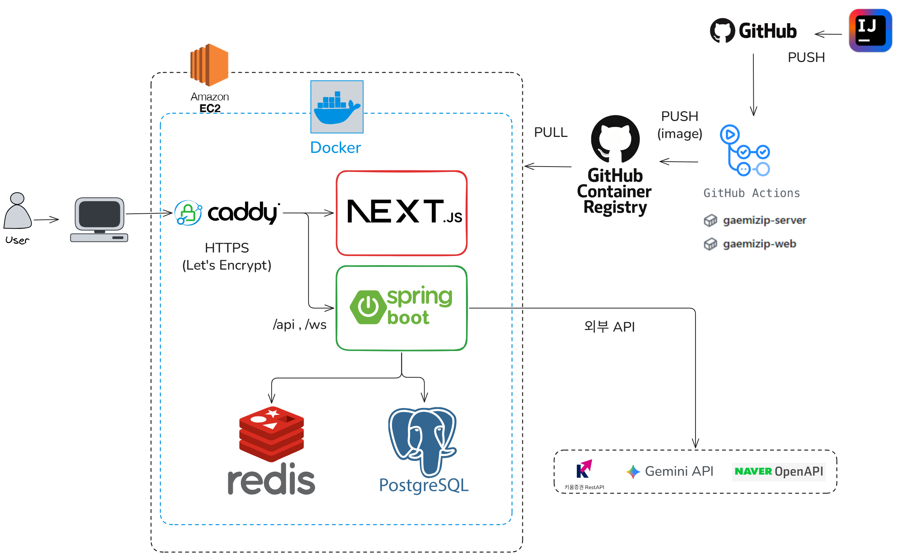

# 개인 투자자를 위한 모의투자 플랫폼 - gaemiZIP

> [gaemiZIP 보러가기](https://gaemizip.duckdns.org/)

개인 투자자("개미")를 위한 실시간 시세·모의 매매·커뮤니티·AI 시장 분석을 제공하는 1인 풀스택 프로젝트입니다.
백엔드 설계·구현·인프라를 전담했고, 프론트엔드는 AI 도구로 구현 후 직접 검증·수정했습니다.

---
## 핵심 기능

- **실시간 시세/차트**: 키움 WebSocket 체결·호가 실시간 반영, 캔들 차트, 주요 지수
- **모의 매매**: 즉시 체결 매수/매도, 지정가 예약 주문(현재가 도달 시 자동 체결) + 체결 알림
- **인증**: JWT + Google OAuth, 신규 가입 시 1억 원 초기 잔고 부여
- **커뮤니티**: 게시판(태그·인기글·보유종목 공유), 댓글/대댓글, 추천
- **AI 시장 분석**: 최신 뉴스 기반 Gemini 2.5 Flash 시장 테마·관련 종목 분석

---
## 기술 스택

| 구분 | 스택 |
|---|---|
| 백엔드 |   -6DB33F?style=for-the-badge&logo=springsecurity&logoColor=white)    |
| 프론트엔드 |       |
| 데이터베이스 |   |
| 인프라 |    -2088FF?style=for-the-badge&logo=githubactions&logoColor=white) |
| 테스트/부하검증 |   |
| 외부 연동 | 키움증권 Open API, Google Gemini 2.5 Flash, 네이버 뉴스 검색 API, Google OAuth 2.0 |

---
## 아키텍처

### ERD

---
## 트러블 슈팅

### 1. 동시성 결함 — 같은 데이터를 동시에 수정할 때 값 유실
- 증상: 예약 체결·즉시 매수에서 이력 11건 대비 보유 수량 일부만 반영 (20/20회)
- 원인: 회원 행 락 없이 "조회 → 차감 → 갱신" 수행, `Holding` 유니크 제약 부재
- 해결: 비관적 락 + 유니크 제약, 주문 단위 트랜잭션 분리
- 결과: 결함 재현율 100% → 0% (20회 반복), 즉시 매수 서버 오류 45% → 0%, 대신 p95 응답시간 약 38% 증가·예약 체결 처리량 약 23% 감소를 정합성 우선으로 수용
- [상세 보기](docs/troubleshooting/01-concurrency.md)

### 2. 캐시 스탬피드 — 종목 상세 조회 실패 (외부 API 429)
- 증상: 종목 상세 진입 시 간헐적 조회 실패, 새로고침하면 정상
- 원인: 콜드 캐시에서 동시 요청이 같은 종목을 키움 API에 중복 조회해 429 발생
- 해결: 같은 종목의 진행 중 호출을 공유하는 요청 병합, 랭킹 갱신 주기 5초 → 30초
- 결과: 빈 응답 91.2% → 0%, 평균 응답시간 99.5% 단축(1.46s → 7.45ms), 같은 2분간 처리 요청 72% 증가(k6 50 VU)
- [상세 보기](docs/troubleshooting/02-cache-stampede.md)

### 3. WebSocket 동시 전송 결함 — 시세 중계 틱 유실·전송 지연
- 증상: 연결은 유지되는데 체결 틱 일부 유실, 일부 세션에서 전송 지연
- 원인: I/O 스레드 2개의 같은 세션 동시 쓰기, 느린 세션의 순차 블로킹 전송, 실패 세션 미제거
- 해결: 세션 단위 `synchronized` 직렬화 + 세션별 비동기 전송 + 실패 세션 즉시 제거
- 결과: 전송 타임아웃 100% 제거(2건/10분 → 0건/17분), 틱 유실 경고 0건 (정규장 실사용 로그)
- [상세 보기](docs/troubleshooting/03-websocket-broadcast.md)

> 이전 버전의 상세 README는 [docs/README_full.md](docs/README_full.md)에 보관
